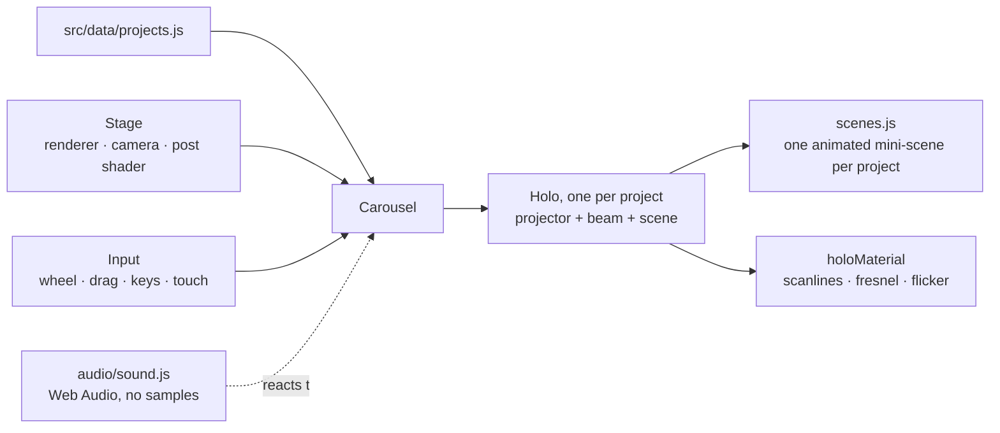

<h1 align="center">Portfolio</h1>

<p align="center">Interactive Three.js portfolio: each project is a procedural hologram on a spiral carousel, with custom post-processing and generative sound.</p>

<p align="center">Live at <a href="https://portfolio.dimedata.cloud">portfolio.dimedata.cloud</a></p>


## What it is

A single-page portfolio for Dime Data and Christian Dixon. Visitors step through projects on a 3D carousel. Each project has its own animated mini-scene, and selecting one opens a detail panel with the description, stack and links.


## Features

- Spiral carousel of project holograms, driven by mouse wheel, drag, keyboard and touch.
- One procedural scene per project, built from Three.js primitives. No models or textures are loaded.
- Custom holographic material (scanlines, fresnel, flicker) and a post-processing shader.
- Synthesised sound in Web Audio. There are no audio files, and sound can be toggled on or off.
- Detail panel per project with status, stack and links.
- Real semantic HTML underneath the canvas for search engines and screen readers.

## How it works



- **`src/data/projects.js` is the only content file.** It holds the project list, the social links and the contact details. Adding an entry there puts it on the carousel, in the labels and in the detail panel.
- **Link policy.** A project shows a live URL if one exists, a public repo link if the repo is public, and otherwise "private repo, available on request". Do not add a link to a private repo.
- **Scenes are keyed by slug.** Each entry in `src/experience/scenes.js` (`builders`) is matched to a project by its `slug`.

## Project structure

```
index.html                 Page shell and the server-rendered project list
src/main.js                Boot sequence (fonts, then scene)
src/data/projects.js       All content: projects, socials, meta
src/experience/Stage.js    Renderer, camera, post-processing
src/experience/Carousel.js Ring layout and selection
src/experience/Holo.js     One hologram: projector, beam, label
src/experience/scenes.js   Procedural mini-scene per project
src/experience/holoMaterial.js  Hologram shader material
src/experience/Input.js    Wheel, drag, keys, touch
src/audio/sound.js         Web Audio sound design
src/ui/interface.js        Detail panel, about overlay, menu
src/styles/main.css        Styles and font loading
wrangler.toml              Cloudflare route and static asset directory
deploy.mjs                 Deploy script (wrangler deploy)
```

## Requirements

- Node.js with npm.
- A WebGL-capable browser for development and review.

## Quick start

```bash
npm install
npm run dev          # Vite dev server
```

Other scripts:

```bash
npm run build        # Production build into dist/
npm run preview      # Serve dist/ on a local port (vite preview)
```

## Configuration

Deployment reads its credentials from the environment. Nothing is written to disk.

| Name | Required | Purpose |
|---|---|---|
| `CLOUDFLARE_API_TOKEN` | Yes, for deploy | Workers and DNS edit token |
| `CLOUDFLARE_ACCOUNT_ID` | Yes, for deploy | Account that owns the `dimedata.cloud` zone |
| `KEYS_FILE` | No | Path to a local markdown file that contains `API Token` and `Account ID` rows. Keep it outside the repo. |

Copy `.env.example` to `.env` for local use. `.env` files are git-ignored.

## Deploy

The site is deployed to Cloudflare Workers as static assets. The custom domain is set by the route in `wrangler.toml`.

```bash
cp .env.example .env    # fill in CLOUDFLARE_API_TOKEN and CLOUDFLARE_ACCOUNT_ID
npm run build && node --env-file=.env deploy.mjs
```

To deploy under a different domain, change the route in `wrangler.toml` and make sure the zone exists on the account.

## Scripts

These are review and verification tools. They use Playwright, so install a browser first.

| Script | What it does |
|---|---|
| `shots.mjs` | Screenshots of the key page states at desktop and mobile sizes |
| `holo-shots.mjs` | Screenshot of each hologram, plus a hover state and a rough frame-rate average |
| `fps-check.mjs` | Relative frame-rate comparison of two URLs: `node fps-check.mjs <urlA> <urlB>` |
| `audio-check.mjs` | Checks that the sound engine starts and responds |
| `sound-verify.html` | Manual page for checking the sound engine |
| `og.mjs` | Renders `public/og.png`, the 1200 x 630 social card |

`shots.mjs`, `holo-shots.mjs` and `audio-check.mjs` take an optional URL argument and default to `http://localhost:4400/`. Start a server first with `npx vite preview --port 4400`.

## Testing

There is no automated test suite. Verification is done with the scripts above and by checking the carousel in a browser after a change.

## Status

The project list is current as of the last content update. Each project's status line is set in `src/data/projects.js`, and the About timeline is in `index.html`. Review both when a project changes state.

## Credits

Typefaces: Clash Display and Satoshi from [Fontshare](https://www.fontshare.com), loaded from their CDN under the Fontshare licence.

## License

Code is released under the [MIT License](LICENSE). Built by [Dime Data](https://dimedata.cloud).
