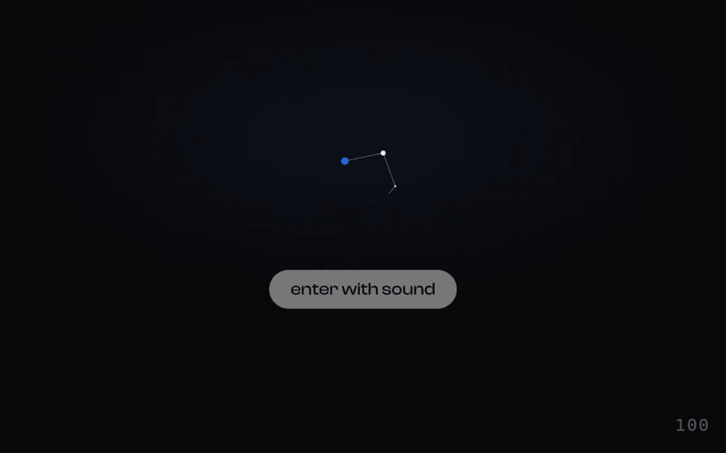
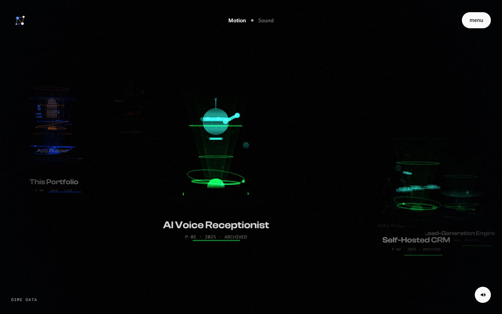
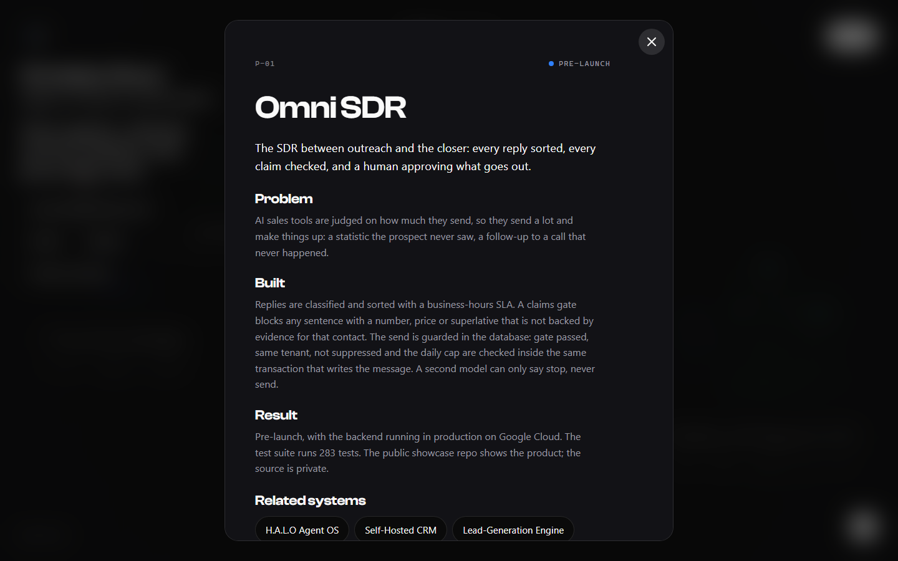
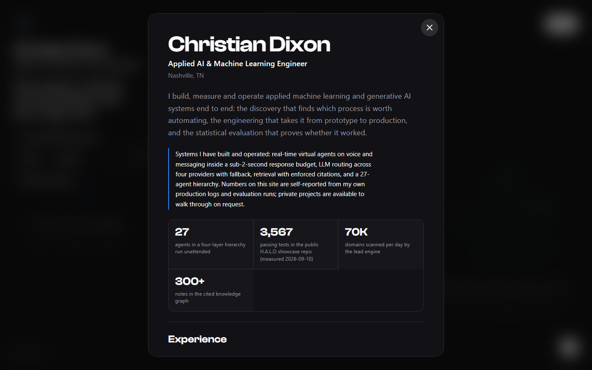
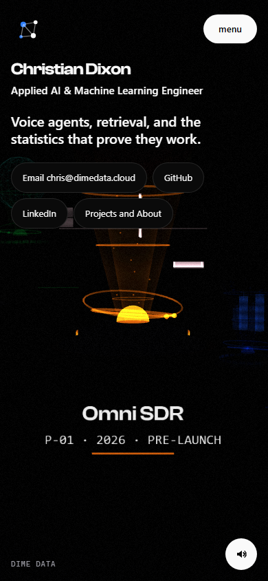
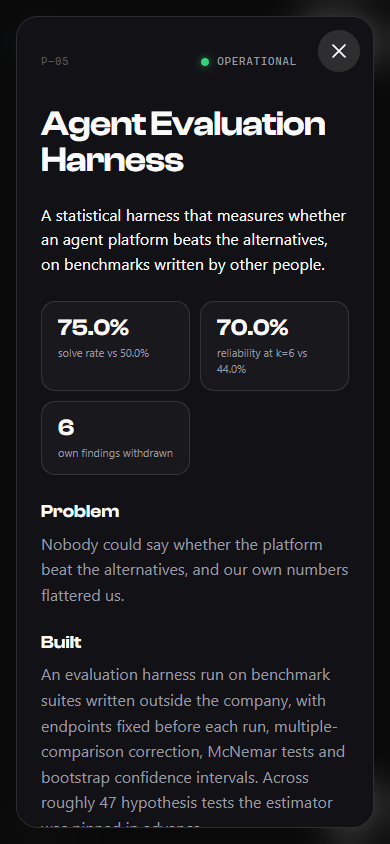
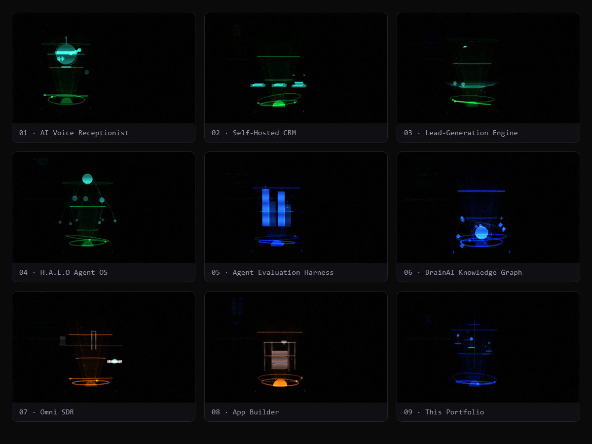
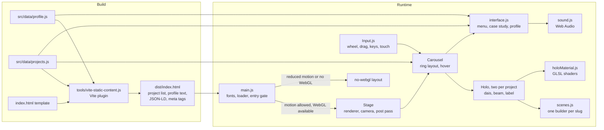

<div align="center">

# Christian Dixon

**An interactive 3D portfolio where every project is a procedural hologram**

[portfolio.dimedata.cloud](https://portfolio.dimedata.cloud)

[](https://github.com/DimeDataCloud/portfolio/actions/workflows/ci.yml)
[](LICENSE)
[](https://threejs.org)
[](https://vitejs.dev)



</div>

| | |
|---|---|
|  |  |
|  |  |
|  |  |

## What this shows

- **No asset files.** Every scene is built from Three.js primitives and custom GLSL. Sound is synthesised with Web Audio. The repository has no 3D models, textures or audio files.
- **A performance budget that CI enforces.** Gzipped JavaScript, Three.js included, must stay under 160 KB. A build check fails the pipeline when it does not. The current build measures 152 KB.
- **Content as data.** Two data files drive the WebGL interface, the no-JavaScript HTML, the meta tags and the JSON-LD. A Vite plugin writes the same content into the built `index.html`.
- **Guardrails in the pipeline.** A content check fails the build on broken or private links, missing scene builders, em dashes, phone numbers and secret-shaped strings.

## The person behind it

**Applied AI & Machine Learning Engineer**, Nashville, TN.

> I build, measure and operate applied machine learning and generative AI systems end to end: the discovery that finds which process is worth automating, the engineering that takes it from prototype to production, and the statistical evaluation that proves whether it worked.

Email chris@dimedata.cloud · [LinkedIn](https://www.linkedin.com/in/christian-s-dixon) · [GitHub](https://github.com/DimeDataCloud)

| Headline number | What it measures (self-reported from my own production logs and evaluation runs) | Evidence |
|---|---|---|
| 27 | agents running unattended in a four-layer hierarchy | private, walkthrough on request |
| 3,567 | passing tests in the public H.A.L.O showcase repo (measured 2026-09-10) | [HALO showcase](https://github.com/DimeDataCloud/halo-agent-showcase#by-the-numbers) |
| 70K | domains scanned per day by the lead engine | [lead engine showcase](https://github.com/DimeDataCloud/lead-engine-showcase) |
| 300+ | notes in the cited knowledge graph | [BrainAI graph](https://github.com/DimeDataCloud/brain-graph) |

## Case studies

| Project | What it is | Key metric | Status | Link |
|---|---|---|---|---|
| Omni SDR | Sales development layer that checks every claim before a human-approved send | Database-enforced send guard; 283 tests | Pre-launch | [live](https://omnisdr.com), [repo](https://github.com/DimeDataCloud/omni-sdr-showcase) |
| H.A.L.O Agent OS | Operating system for a one-person business, 27 agents in four layers | 578 tokens of fixed overhead per turn | Paused, case study | [repo](https://github.com/DimeDataCloud/halo-agent-showcase) |
| AI Voice Receptionist | Virtual agent that answers the phone, qualifies the caller and books the appointment | Under 2 s response budget | Case study | private, available on request |
| Agent Evaluation Harness | Statistical harness on benchmarks written outside the company | About 47 hypothesis tests | Operational | private, available on request |
| Open ClaudeOS | Claude proposes, deterministic code decides, and the user approves a card (C# on .NET 10, WinUI 3) | 434 tests | Open source, Apache-2.0 | [repo](https://github.com/DimeDataCloud/open-ClaudeOS) |
| BrainAI Knowledge Graph | 300+ wikilinked notes in Neo4j, read by Claude over a read-only MCP server | Every Cypher statement checked and run read-only | Operational | [repo](https://github.com/DimeDataCloud/brain-graph) |
| Self-Hosted CRM | Pipelines, funnels and a Call Room that prepares the rep before every dial | Under 10% of replies escalated to a person | Case study | [repo](https://github.com/DimeDataCloud/crm-showcase) |
| Lead-Generation Engine | Two-axis lead scoring from free public signals | 70K domains scanned per day | Case study | [repo](https://github.com/DimeDataCloud/lead-engine-showcase) |
| Lobby | Shared canvas where humans and AI agents post artifacts | Bot tokens scoped to one workspace | Open source, MIT | [repo](https://github.com/DimeDataCloud/lobby) |
| Claude Modder | Fleet orchestrator for Claude Code sessions with a learning permission gate | Safety property tested over 400 random histories | Open source, MIT | [repo](https://github.com/DimeDataCloud/claude-modder) |
| Open Waddle | Desktop AI agent drawn as a pixel-art duck that asks before it acts | Four deterministic permission tiers | Open source, MIT | [repo](https://github.com/DimeDataCloud/Open-Waddle) |
| Jamlink | Browser-only two-player guitar jamming over WebRTC | Enforced 60 ms latency budget | Open source, MIT | [repo](https://github.com/DimeDataCloud/jamlink) |
| Trading Bot | Paper-only research desk with pre-registered experiments. Not financial advice. | Hash-chained audit log | Paper trading only, MIT | [repo](https://github.com/DimeDataCloud/trading-bot) |
| This Portfolio | Procedural 3D portfolio on Three.js, with a custom post pass | About 150 KB gzipped, Three.js included | Live | [live](https://portfolio.dimedata.cloud), [repo](https://github.com/DimeDataCloud/portfolio) |

Private projects appear on the site with their case study text and no links.

## How it works



- **Content flows one way.** `src/data/` is the only copy. The build plugin writes it into the HTML for crawlers and no-JavaScript readers. The runtime reads the same files for the holograms, the menu and the overlays.
- **The 3D view is optional.** Reduced-motion visitors and browsers without WebGL get the same content as a list, and the WebGL view is never created for them.
- **Each hologram is built in code.** A shared shader factory provides the scanlines, fresnel edges, status arc and dust motes. Each project supplies one mini scene that runs inside the beam.

Full detail is in [docs/ARCHITECTURE.md](docs/ARCHITECTURE.md).

### Project structure

```
index.html                       Page shell, loader, overlays, build placeholders
public/og.png                    1200 x 630 social card (rendered by tools/og.mjs)
public/_headers                  Cloudflare headers: nosniff, referrer policy, immutable cache for /assets/*
src/main.js                      Boot: fonts, loader, entry gate, WebGL or fallback
src/data/profile.js              Profile, headline metrics, experience, skills, contact
src/data/projects.js             The fourteen projects: the single source for project copy
src/experience/Stage.js          Renderer, camera, parallax, post pass
src/experience/Carousel.js       Spiral layout, hover picking, focus
src/experience/Holo.js           One hologram: dais, beam, caustics, motes, label
src/experience/holoMaterial.js   Hologram shader factory (GLSL)
src/experience/scenes.js         Nine procedural mini scenes, keyed by slug
src/experience/Input.js          Wheel, drag, touch, keyboard, pointer
src/shaders/postShader.js        Grain and vignette composite
src/audio/sound.js               Web Audio ambient pad and interaction sounds
src/loader/mark.js               Canvas loader animation
src/ui/interface.js              Menu, case study, profile overlay, focus management
src/ui/icons.js                  Brand icon paths (simple-icons)
src/styles/main.css             Design tokens, layout, reduced-motion and no-WebGL styles
tools/vite-static-content.js     Vite plugin: build-time HTML, JSON-LD, meta tags
tools/check-content.mjs          Guardrails: links, copy rules, secrets, scene builders
tools/content-rules.mjs          Pure rule predicates used by the guardrails and the unit tests
tools/test/                      Unit tests (node:test): static HTML, JSON-LD, guardrail rules
tools/a11y.mjs                   axe-core accessibility pass (static list and case-study dialog)
tools/check-bundle.mjs           Gzipped JavaScript budget (160 KB)
tools/deploy.mjs                 Cloudflare Workers deploy, credentials from the environment
tools/shots.mjs                  Playwright screenshots of key states
tools/holo-shots.mjs             Playwright captures of each hologram and a rough frame rate
tools/fps-check.mjs              Relative frame-rate comparison of two URLs
tools/audio-check.mjs            Playwright check that the sound engine starts and responds
tools/sound-verify.html          Manual page for checking the sound engine
tools/og.mjs                     Renders public/og.png
docs/                            Architecture, design, content guide, screenshots
wrangler.toml                    Cloudflare route and static asset directory
vite.config.js                   Vite config with the static-content plugin
.github/workflows/ci.yml         Guardrails, build and bundle budget on every push and PR
```

## Quick start

Requires Node 22 (see `.nvmrc`) and a WebGL-capable browser.

```bash
npm ci                    # install
npm run dev               # Vite dev server
npm run verify            # content guardrails, then production build
npm test                  # unit tests (node:test)
npm run check:bundle      # gzipped JS budget, run after a build
npm run preview           # serve dist/ locally
```

Playwright tools need a browser once: `npx playwright install chromium`.

On Windows arm64, npm can skip the native rollup and esbuild binaries and the build fails. Add them with `npm install --no-save --force @rollup/rollup-win32-arm64-msvc@<rollup> @esbuild/win32-arm64@<esbuild>`, using the versions in `package-lock.json`.

## Deploy

The site deploys to Cloudflare Workers as static assets from `dist/`. The route `portfolio.dimedata.cloud/*` on the `dimedata.cloud` zone is set in `wrangler.toml`.

Credentials come from the environment only. Nothing is written to disk.

| Variable | Purpose |
|---|---|
| `CLOUDFLARE_API_TOKEN` | Token with Workers and DNS edit access |
| `CLOUDFLARE_ACCOUNT_ID` | Account that owns the zone |

```bash
cp .env.example .env                       # fill in the two values; .env is git-ignored
npm run build
node --env-file=.env tools/deploy.mjs      # or: npm run deploy, with the variables exported
```

To deploy under another domain, change the route in `wrangler.toml` and make sure the zone exists on the account.

## Quality gates

- **`npm run verify`** runs the content guardrails (`tools/check-content.mjs`) and then the production build.
- **CI** (`.github/workflows/ci.yml`) runs on every push and pull request on Ubuntu with Node 22. It installs with `npm ci --ignore-scripts`, then runs the content guardrails, the unit tests, the build, the bundle budget, the smoke test and the accessibility pass.
- **Unit tests.** `npm test` runs the Node test runner (`node:test`, no extra dependencies) over `tools/test/`. It covers the build-time HTML and JSON-LD from `tools/vite-static-content.js`, each content guardrail rule in `tools/content-rules.mjs`, and a run of the guardrail script on this repository.
- **Accessibility.** `npm run a11y` runs axe-core (`@axe-core/playwright`, pinned) against the built site: the static project list at desktop and phone widths, and the case-study dialog open at both. It fails on serious or critical WCAG 2.0/2.1 A and AA violations. It needs a running preview or a URL argument, and CI runs it against `vite preview`.
- **Bundle budget.** Gzipped JavaScript across `dist/assets` must stay under 160 KB. The current build measures 151.3 KB, with Three.js included.
- **Content rules** enforced by the guardrails: every project has the required fields and a unique slug; links are `https`; a project with no public link has a `privateNote`; every slug has a scene builder; every `related` slug names a project; shared-pattern ids are defined and used; no metric chip is a bare count under 100, and no small count is used as evidence in copy; the contact email is the public one; no em dashes, phone numbers or secret-shaped strings in site source.
- **Review** uses the Playwright scripts above on desktop and phone sizes. They run locally; `smoke`, `a11y` and the unit tests also run in CI.

## Fonts, icons and licence

- Typefaces are Clash Display and Satoshi from [Fontshare](https://www.fontshare.com), loaded from the Fontshare CDN under the Fontshare licence.
- Brand icons are path data from [simple-icons](https://github.com/simple-icons/simple-icons), used under its licence.
- Code is released under the [MIT License](LICENSE). Copyright Dime Data, built by [Dime Data](https://dimedata.cloud).

For contributions, see [CONTRIBUTING.md](CONTRIBUTING.md). For the design principles and the content guide, see [docs/DESIGN.md](docs/DESIGN.md) and [docs/CONTENT.md](docs/CONTENT.md).
