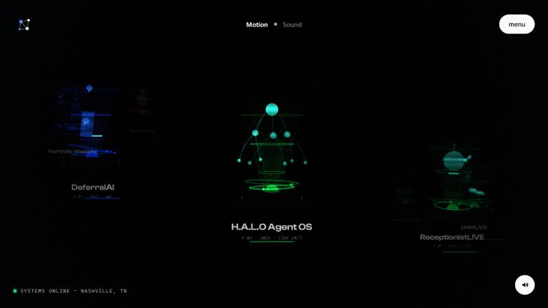
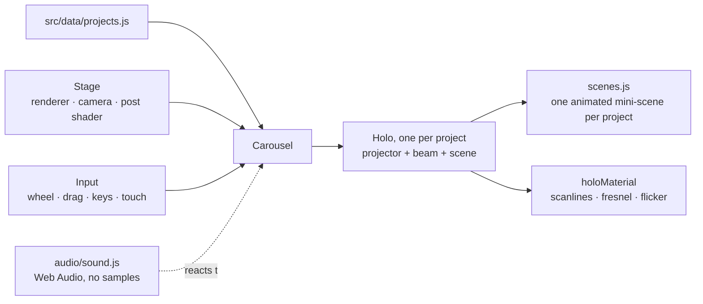

# portfolio

Source of [portfolio.dimedata.cloud](https://portfolio.dimedata.cloud): an interactive Three.js
portfolio where each project is a miniature hologram on a spiral carousel, with custom
post-processing and generative sound.



## How it works



- **`projects.js` is the only content file.** Add an entry and the carousel, labels and
  detail panel pick it up. Links follow one rule: live URL if it exists, public repo if not,
  otherwise "private, available on request". No dead links.
- **Every hologram scene is procedural.** No models or textures, just Three.js primitives
  driven by `holoMaterial`'s shader.
- **Sound is synthesised** in Web Audio at runtime. There are no audio files.

## Run

```bash
npm install
npm run dev
```

## Deploy

Deploys to Cloudflare Workers as static assets. The custom domain is set by the route in
`wrangler.toml`.

```bash
cp .env.example .env    # fill in CLOUDFLARE_API_TOKEN and CLOUDFLARE_ACCOUNT_ID
npm run build && node --env-file=.env deploy.mjs
```

Change the route in `wrangler.toml` to deploy under your own domain.

## Scripts

| Script | What it does |
|---|---|
| `shots.mjs` · `holo-shots.mjs` | Playwright screenshots of the page and of each hologram |
| `fps-check.mjs` | Frame-rate check under load |
| `audio-check.mjs` · `sound-verify.html` | Confirms the sound engine starts and responds |
| `og.mjs` | Renders `public/og.png`, the social card |

Each one takes a URL argument and defaults to `http://localhost:4400/` (`npx vite preview --port 4400`).

## Credits

Typefaces: Clash Display and Satoshi from [Fontshare](https://www.fontshare.com), loaded from
their CDN under the Fontshare licence.

## License

MIT for the code. Built by [Dime Data](https://dimedata.cloud).
